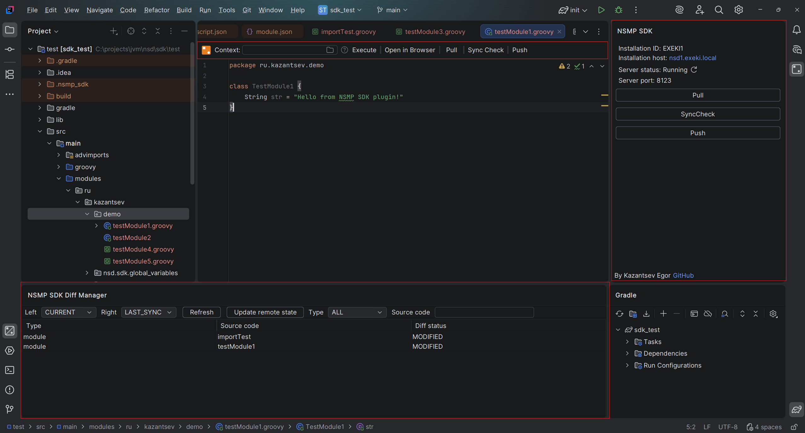
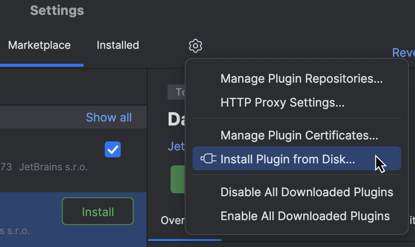
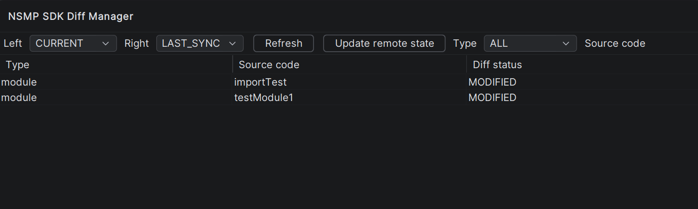
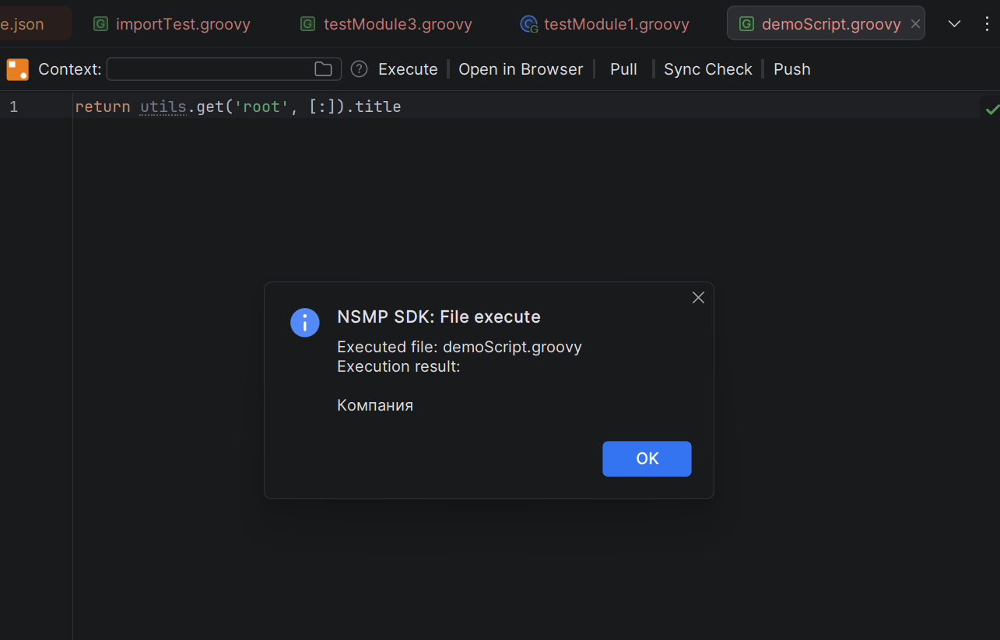

# NSMP SDK IntelliJ Plugin

## 1. О плагине

Плагин предназначен для использования в среде [IDE базированных на IntelliJ Platform](https://www.jetbrains.com/ru-ru/opensource/intellij-platform/) и призван упростить работу с исходниками платформы [Naumen Service Management Platform](https://www.naumen.ru/products/smp/).  
Его основная задача - упрощение навигации и минимизация ручных действий с исходниками платформы. 

**Плагин не является продуктом компании Naumen**. Важно отметить, что компания Naumen имеет подобный инструментарий, но его реализация меня не полностью устроила, поэтому вы видите данный проект.

### Основные возможности

1. Синхронизация исходников между инсталляцией и средой разработки на машине разработчика путем поставки git-подобного функционала (`pull` / `push` / `sync check`)
2. Работа с модулями, скриптами и конфигурациями импортов (advImport) 
3. Выполнение Groovy-скриптов из IDE путем отправки их на инсталляцию (без сохранения)
4. Визуальное сравнение версий исходников (локальная, удаленная и последняя синхронизированная версии)
5. Локальный HTTP-сервер для интеграции другими инструментами среды NSMP SDK и прочими внешними инструментами
6. Горячие клавиши



## 2. Требования 

1. IDE на базе JetBrains Platform 2025.2.4+ (проводились тесты на OpenIDE, IntelliJ IDEA)
2. Сетевой доступ к вашей инсталляции NSMP (тестировалось только на Naumen Service Desk)
3. Руки или их функциональный заменитель

## 3. Ручная установка

Скачайте последнюю версию плагина из вкладки [releases](https://github.com/exeki/nsmp.sdk.intellij_plugin/releases) репозитория 
и установите вручную в разделе **Plugins** вашей IDE при помощи функции "Install plugin from disk", доступной из шестеренки в верхней панели окна.



Подробнее в [официальной документации JetBrains](https://www.jetbrains.com/help/idea/managing-plugins.html#install_plugin_from_disk)

## 4. Быстрый старт

1. Установите модули [web_api_components](https://github.com/exeki/nsmp.modules.web_api_components) и [sdk_controller](https://github.com/exeki/nsmp.modules.sdk_controller) на свою инсталляцию (на все инсталляции, с которыми хотите работать из плагина). Модуль sdk_controller содержит в себе необходимые для работы плагина эндпойнты, а web_api_components это его зависимость.
2. Откройте или создайте проект для работы с исходниками. 
3. В настройках вашей IDE в разделе **Tools** найдите раздел **NSMP SDK** - это раздел настроек плагина.
4. Добавьте данные вашей инсталляции, в том числе access key суперпользователя
> Крайне рекомендуется указывать ключ суперпользователя, а в GUI ходить под другим пользователем, закрепленным за суперпользователем.
> Это не повлечет за собой никаких ограничений в части функциональности в GUI, но позволяет не перелогиниваться каждый раз после выполнения какой-либо команды в плагине.
> Разлогин связан с тем, что платформа NSMP автоматически заканчивает все сессии пользователя, если под его ключом было выполнено обращение к API.
> Закреплять пользователя за суперпользователем может только system, так что если у вас нет system доступа к инсталляции - не пытайтесь сделать это сами.
5. Укажите в настройках вашего проекта используемую инсталляцию
> Плагин будет активирован только после выбора инсталляции.
> После того, как вы начали работать с исходниками менять инсталляцию крайне не рекомендуется.
6. Выполните ваш первый pull.
> С этого момента плагин полнофункционален и более никакие настройки не требуются в рамках текущего проекта. Прочие настройки опциональны. Они описаны [тут](docs/settings.md)
> Для новых проектов вам нужно будет только выбрать инсталляцию.

## 5. Связанные инструменты

Настоятельно рекомендуется использовать текущий плагин с указанными ниже инструментами:
### 5.1 [NSMP SDK Gradle Plugin](https://github.com/exeki/nsmp.sdk.gradle_plugin) 

Плагин призван настроить систему сборки gradle для работы с платформой NSMP. 
Основные его задачи: 
1. Отметить папки с исходниками NSMP как source root
2. Добавляет в зависимости текущего проекта набор библиотек, присутствующих внутри платформы
3. Добавляет в зависимости текущего проекта отдельную библиотеку [nsd.sdk.global_variables](https://github.com/exeki/nsd.sdk.global_variables), которая поставляет набор классов, схожий по сигнатурам с API платформы. 
### 5.2 [NSMP SDK Browser Plugin](https://github.com/exeki/nsmp.sdk.browser_plugin)

Просто позволяет выполнить pull исходника в вашу IDE прямо из браузера.
**Пока не доступно**. 

> Локальный HTTP сервер внутри плагина поднимается исключительно для интеграции с этими инструментами. 
> Как правило - плагин IDE является источником информации для них.

## 6.  Функционал

### 6.1.  Операции синхронизации

Операции синхронизации обеспечивают работу с исходниками NSMP в git - подобной форме. 
Функционал базируется на библиотеке [nsmp.sdk.sources_sync](https://github.com/exeki/nsmp.sdk.sources_sync).
Вызов операций синхронизации доступен из:

- Правый Tool Window плагина - для выполнения операций глобально для проекта
- Editor Top Panel (панель над окном редактирования файла) - для выполнения операций для текущего файла

- Три основных операции:

- **pull** - загрузка исходников из инсталляции в локальную IDE
- **sync check** - проверка, соответствует ли локальные чексуммы исходников, сохраненные с последней синхронизации, с чексуммами исходников на сервере
- **push** - загрузка исходников из локальной IDE на инсталляцию. Перед выполнением производится `sync check`, дабы не допустить удаления изменений исходника, совершенных другим разработчиком. `Sync check` можно пропустить указав параметр `force = true` при выполнении операции

**Важно**: чексуммы исходников помимо текста исходников учитывают их места применения. 

Чуть подробнее об алгоритмах этих операций можно почитать [тут](docs/syncOperations.md).

### 6.2. Diff Manager

Diff Manager - это панель для визуального сравнения состояний исходников. 
Полезна в случае возникновения конфликта при попытке push, либо если нужно осмотреть внесенные в исходник изменения.
Diff Manager располагается в нижнем Tool Window.

Предоставляет два селектора для выбора сравниваемых состояний. 
К выбору доступны три состояния:
- `current` - текущее состояние исходников в папке src/main
- `last_sync` - состояние, зафиксированное на момент последней синхронизации исходника при pull или push
- `remote` - состояние исходников на инсталляции. Файлы этого состояния обновляются вручную при нажатии кнопки **update remote state**

Таблица не обновляется автоматически при внесении изменений в проект, поэтому, чтобы осмотреть изменения, предварительно нажмите кнопку **refresh** над шапкой таблицы.



### 6.3. Выполнение скриптов

Под выполнением скрипта подразумевается просто отправка скрипта на инсталляцию при помощи штатного эндпойнта платформы '/exec'.
Подробнее о нем вы можете почитать в [документации Naumen](https://www.naumen.ru/docs/sd/Content/RESTful/REST_API_method.htm?Highlight=exec.%20Выполнение%20скрипта%20из%20файла#exec).

Выполнение инициируется кнопкой "Execute" в Editor Top Panel.

Рядом с кнопкой присутствует поле контекста, где вы можете выбрать другой скрипт, который будет выступать в роли контекста для выполняемого скрипта. 
Таким образом, для выполнения production скрипта для действия по событию не придется его редактировать, чтобы задать переменную subject, например. 
Достаточно будет объявить переменную subject в другом скрипте, задать скрипт как контекст для текущего, и выполнить текущий скрипт.

Подстановка контекста реализуется довольно простым образом: 
1. Их обоих скриптов вырезается package
2. Происходит конкатенация скриптов, где скрипт контекста сверху
3. В таком виде скрипт отправляется на инсталляцию

Пример скрипта контекста:
```groovy
def subject = utils.get('employee$123')
```
Пример скрипта, выполняемого с указанным выше контекстом:
```groovy
utils.edit(subject, ['removed' : false])
```



### 6.4. Горячие клавиши

Почти на каждую функцию плагина предусмотрена горячая клавиша. 
Здесь я не буду расписывать их конфигурацию, вы можете ее осмотреть 
и главное **отредактировать** под себя при помощи штатного для JetBrains IDE функционала.

> Путь к настройкам горячих клавиш:
> Settings → Keymap → Plugins → NSMP SDK

## 7. Лицензия

[MIT](LICENSE)

## 8. Troubleshooting

По проблемам создайте Issue в текущем репозитории.

## 9. Контакты

[Указаны в профиле GitHub](https://github.com/exeki).

## 10. Благодарности

- Команде Naumen
- Конечно же мне, теперь поставь звезду пожалуйста


