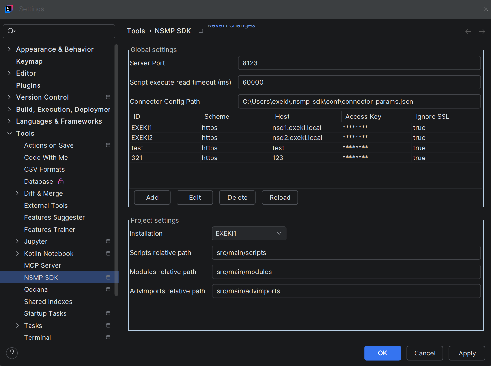

# Настройки плагина

> Путь к настройкам плагина в IDE: 
> Settings → Tools → NSMP SDK

###  Глобальные настройки

- Server Port — порт локального HTTP-сервера (по умолчанию 8123; 0 = сервер не запускается)
- Script execute read timeout — таймаут выполнения скрипта
- Connector Config Path — путь к файлу конфигурации подключений к инсталляциям (по умолчанию вынесен за проект для переиспользования и недопущения утечки секретов)
- Таблица конфигураций инсталляций: ID, scheme, host, access key, ignore SSL. Хранится по указанному выше пути в json файле.

###  Настройки проекта

- Installation — какая инсталляция используется в текущем проекте
- Scripts / Modules / AdvImports relative path — относительные пути к группам исходников. 
Крайне не рекомендуется мешать их в одну папку, тк платформа не обеспечивает сквозную уникальность кодов исходников меж типами.

